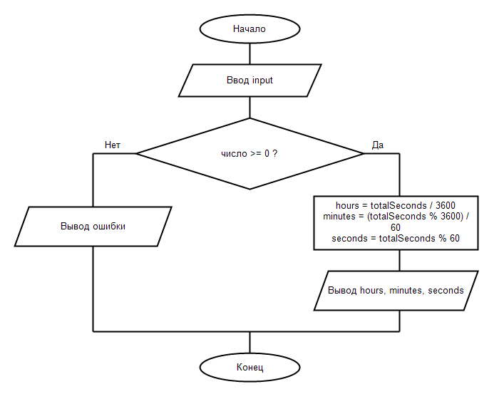

# СРСП 1. Перевод секунд в часы, минуты и секунды

Студент: Нурланулы Адилет, группа ис25 26Б

## 1. Словесная запись алгоритма
1. Начало.
2. Вывести приглашение и считать строку input.
3. Проверить, является ли input целым числом (totalSeconds) и выполняется ли условие totalSeconds >= 0.
4. Если условие НЕ выполняется: вывести "Ошибка: введите целое неотрицательное число." и перейти к концу.
5. Если условие выполняется:
   - Вычислить часы: hours = totalSeconds / 3600
   - Вычислить минуты: minutes = (totalSeconds % 3600) / 60
   - Вычислить секунды: seconds = totalSeconds % 60
   - Вывести: hours ч. minutes мин. seconds сек.
6. Конец.

## 2. Псевдокод
АЛГОРИТМ ПереводСекунд
НАЧАЛО
    ВЫВЕСТИ "Введите количество секунд: "
    ВВЕСТИ input
    ЕСЛИ НЕ ЦелоеЧисло(input, totalSeconds) ИЛИ totalSeconds < 0 ТО
        ВЫВЕСТИ "Ошибка: введите целое неотрицательное число."
    ИНАЧЕ
        hours <- totalSeconds DIV 3600
        minutes <- (totalSeconds MOD 3600) DIV 60
        seconds <- totalSeconds MOD 60
        ВЫВЕСТИ hours, " ч. ", minutes, " мин. ", seconds, " сек."
    КОНЕЦ_ЕСЛИ
КОНЕЦ

## 3. Схема алгоритма по ГОСТ 19.701-90

## 5. Результаты проверки
- Ввод 3725 -> 1 ч. 2 мин. 5 сек.
- Ввод 59 -> 0 ч. 0 мин. 59 сек.
- Ввод 86399 -> 23 ч. 59 мин. 59 сек.
- Ввод 0 -> 0 ч. 0 мин. 0 сек.
- Ввод -5 -> Ошибка: введите целое неотрицательное число.
- Ввод abc -> Ошибка: введите целое неотрицательное число.
